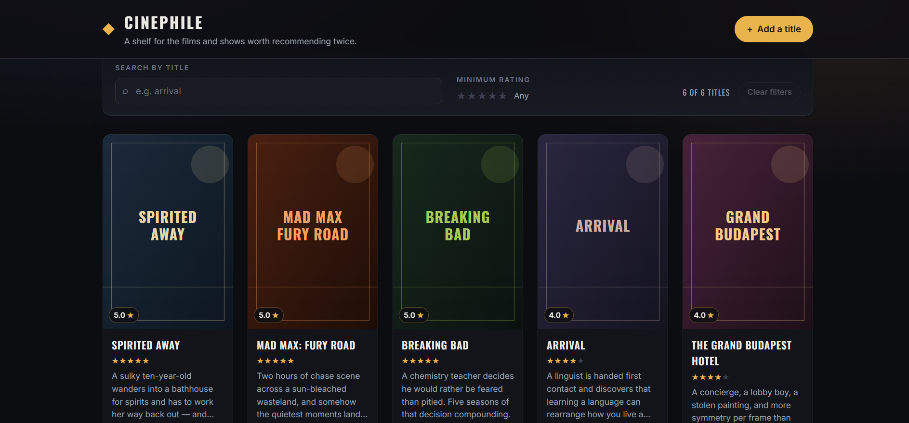

# Cinephile - React Movie App with React Router



A small movie/TV shelf built with React hooks. Add titles, filter them by title
and by minimum star rating, then click any card to open its description and
watch the trailer on its own page.

## Run it

```bash
npm install
npm run dev
```

## Routes

| Path | Page | What it does |
| --- | --- | --- |
| `/` | `src/pages/Home.jsx` | Filter bar, the movie grid, the "add a title" modal |
| `/movie/:id` | `src/pages/MovieDetail.jsx` | Poster, rating, full description, embedded trailer, link back home |
| anything else | `src/pages/NotFound.jsx` | Friendly 404 with a link home |

How the pieces fit together:

- `src/main.jsx` wraps the app in `<BrowserRouter>`.
- `src/App.jsx` declares the `<Routes>` and still owns the shared state
  (`movies`, `titleQuery`, `minRating`), so filters survive a trip to a
  detail page and back.
- `MovieCard` wraps itself in `<Link to={`/movie/${movie.id}`}>`, which is
  what makes the whole card clickable. The remove button is a sibling of
  that link, not a child, so removing a movie never navigates.
- `MovieDetail` reads the id with `useParams()` and finds the movie in the
  list it receives as a prop. An unknown id shows a "not on the shelf"
  message rather than crashing.
- Getting back home: the "← Back to all titles" link on the detail page, or
  the Cinephile brand in the header, which is a `<Link to="/">` on every page.

## Components

| File | Role |
| --- | --- |
| `src/App.jsx` | Shared state (`movies`, `titleQuery`, `minRating`) + route definitions |
| `src/pages/Home.jsx` | The shelf: filter, grid, add-movie modal |
| `src/pages/MovieDetail.jsx` | Description + trailer page for one movie |
| `src/pages/NotFound.jsx` | 404 page |
| `src/components/Masthead.jsx` | Shared header; the brand links home |
| `src/components/MovieCard.jsx` | One movie card, linked to its detail page |
| `src/components/MovieList.jsx` | Maps the filtered array to cards; empty state |
| `src/components/Filter.jsx` | Controlled title search + minimum-rating picker |
| `src/components/AddMovieForm.jsx` | Modal form to add a movie, with validation |
| `src/components/Rating.jsx` | Star rating, read-only or editable |
| `src/data/movies.js` | Seed data — swap in your own favourites |
| `src/utils/trailer.js` | Turns any YouTube link into an embeddable one |

Every movie is `{ id, title, description, posterURL, trailerLink, rating }`.

## Trailer links

`trailerLink` is stored as an embed URL, e.g.
`https://www.youtube.com/embed/VIDEO_ID`. The add-movie form is forgiving:
paste a normal `watch?v=…` link, a `youtu.be/…` link, an embed link or just
the 11-character video id, and `toEmbedUrl()` in `src/utils/trailer.js`
converts it. A movie with no trailer shows a placeholder instead of an empty
black box.

## Hooks used

- `useState` — the movie list, filter values, form fields, modal visibility
- `useMemo` — the filtered list, recomputed only when the list or a filter changes
- `useEffect` — closes the dialog on `Escape`; scrolls the detail page to the top
- `useParams` — reads `:id` out of the URL on the detail page

## Deploying

This is a single-page app, so the host must serve `index.html` for every
path — otherwise a refresh on `/movie/2` returns a 404. On Netlify add a
`public/_redirects` file containing `/* /index.html 200`; on Vercel add a
catch-all rewrite. `vite.config.js` uses `base: '/'` for the same reason.
